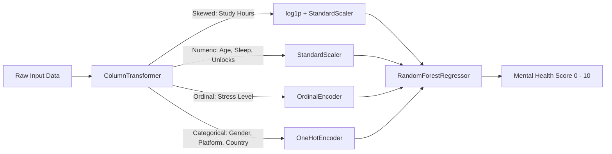

 <div align="center">

# 🧠 Mental Health Score — Student Wellness Analytics

[](https://fastapi.tiangolo.com/)
[](https://www.python.org/)
[](https://scikit-learn.org/)
[](https://render.com/)
[](https://opensource.org/licenses/MIT)

**An end-to-end Machine Learning web application predicting student mental wellness scores (0–10) based on digital habits, lifestyle factors, and perceived stress levels.**

### 🚀 Live Demo

**[🌐 Open Mental Health Score — Live Web App](https://mental-health-score-1-ew8o.onrender.com)**

[🚀 Launch Web App](https://mental-health-score-1-ew8o.onrender.com) • [🌐 Backend API](https://mental-health-score-p8x8.onrender.com) • [📖 Swagger Docs](https://mental-health-score-p8x8.onrender.com/docs) • [✨ Report Bug](https://github.com/) • [💡 Request Feature](https://github.com/)

</div>

---

## 🌟 Key Features

- 🎯 **Machine Learning Pipeline:** Trained using a `RandomForestRegressor` with custom `ColumnTransformer` preprocessing, including logarithmic transforms, scaling, and ordinal/one-hot encodings.
- ⚡ **High-Performance REST API:** Built with **FastAPI** and strict **Pydantic** schema validation.
- 🎨 **Modern Interactive UI:**
  - Semi-circular dynamic SVG gauge meter with smooth easing animations.
  - Granular error diagnostics with automatic field-level validation feedback.
  - Polished editorial aesthetic with glassmorphism effects and modern typography (*Fraunces* + *Inter*).
- ☁️ **Cloud Native:** Configured for cloud deployment on Render.

---

## 🛠️ Tech Stack

| Domain | Technologies |
|---|---|
| **Backend & API** | FastAPI, Uvicorn, Pydantic |
| **Machine Learning** | Scikit-Learn, Joblib, NumPy, Pandas |
| **Frontend** | Vanilla JavaScript (ES6+), HTML5, CSS3 |
| **Data Exploration** | Jupyter Notebook, Matplotlib, Seaborn |
| **Cloud Deployment** | Render |

---

## 🏗️ Architecture & Model Pipeline

The ML pipeline applies specialized preprocessing per feature category before regression:



---

## 📁 Repository Structure

```text
├── Mental_Health_Model.pkl   # Serialized trained scikit-learn pipeline
├── dataset.csv               # Student lifestyle and mental health metrics
├── experiment.ipynb          # EDA, feature engineering, model training and tuning
├── index.html                # Responsive web app interface
├── main.py                   # FastAPI backend and prediction endpoint
├── requirements.txt          # Python dependencies
├── script.js                 # Frontend application logic and API integration
├── style.css                 # Custom design system, layout and animations
└── .gitignore                # Git ignore configuration
```

---

## 🚀 Quick Start (Run Locally)

### 1. Clone the repository

```bash
git clone https://github.com/your-username/Mental-Health-Score.git
cd Mental-Health-Score
```

### 2. Set up a virtual environment

**Windows**

```bash
python -m venv venv
venv\Scripts\activate
```

**macOS / Linux**

```bash
python3 -m venv venv
source venv/bin/activate
```

### 3. Install dependencies

```bash
pip install -r requirements.txt
```

### 4. Run the FastAPI server

```bash
uvicorn main:app --reload
```

The backend will start at `http://127.0.0.1:8000`.

### 5. Launch the Web Interface

Open `index.html` in your browser or serve it through VS Code Live Server.

---

## 🔌 API Reference

### Health Check

```http
GET /
```

**Response (200 OK):**

```json
{
  "message": "Mental Health Score Prediction API is running"
}
```

### Predict Mental Health Score

```http
POST /predict
Content-Type: application/json
```

**Request Payload**

```json
{
  "age": 21,
  "gender": "Male",
  "country": "India",
  "academic_level": "Undergraduate",
  "most_used_platform": "Instagram",
  "purpose_of_use": "Entertainment",
  "avg_daily_usage_hours": 4.5,
  "daily_unlocks": 120,
  "study_hours": 3.0,
  "physical_activity_hours": 1.5,
  "sleep_hours_per_night": 7.0,
  "stress_level": "Medium"
}
```

**Response (200 OK)**

```json
{
  "predicted_mental_health_score": 6.85
}
```

Interactive OpenAPI Swagger documentation is available at `/docs`.

- [Open the deployed API](https://mental-health-score-p8x8.onrender.com)
- [Explore Swagger documentation](https://mental-health-score-p8x8.onrender.com/docs)

---

## 📊 Score Interpretation Guide

| Score Band | Signal Label | Description |
|---|---|---|
| **0.0–3.9** | 🔴 *Signal: Strained* | Suggests elevated stress; lifestyle adjustments may be beneficial. |
| **4.0–6.9** | 🟡 *Signal: Balanced* | Indicates a moderate baseline, with opportunities to improve daily routines. |
| **7.0–10.0** | 🟢 *Signal: Strong* | Indicates lifestyle patterns associated with a stronger wellness baseline. |

---

## ⚠️ Disclaimer

> **Educational use only:** This project demonstrates statistical prediction using lifestyle and digital-habit data. Its scores are not a clinical assessment or psychiatric diagnosis. Anyone experiencing mental distress should consult a qualified healthcare professional.

---

<div align="center">

**Built with ❤️ for student wellness and open-source learning.**

[🌐 Visit Live App](https://mental-health-score-1-ew8o.onrender.com)

</div>
